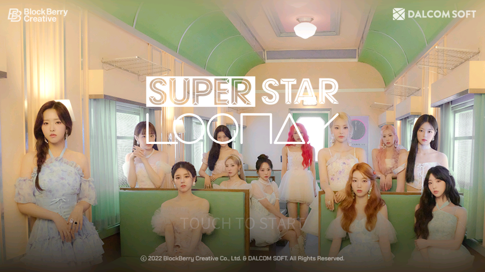
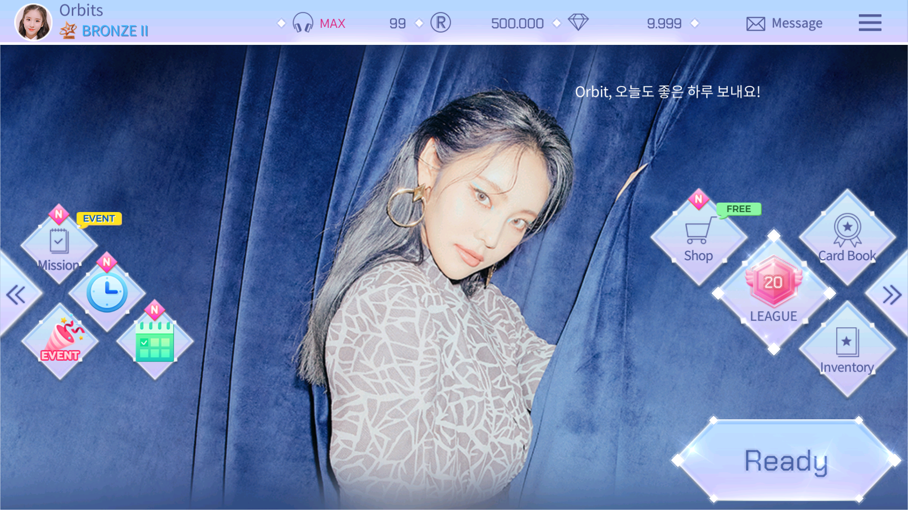
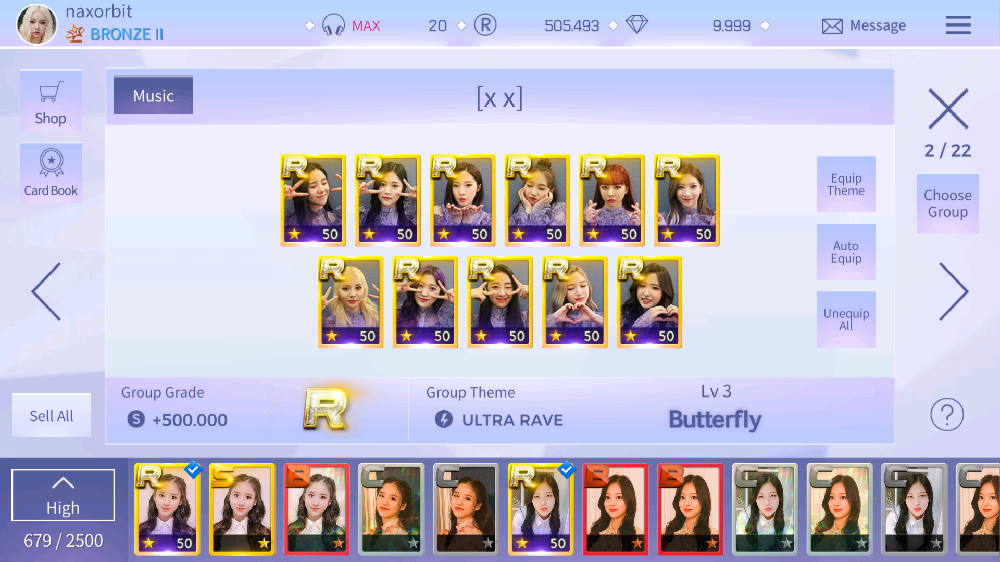
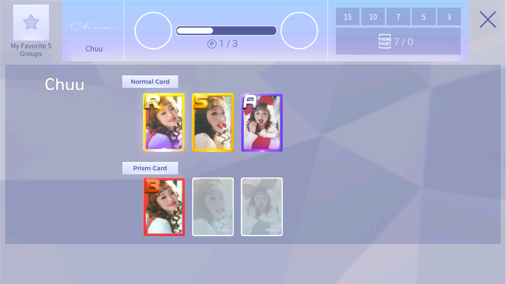
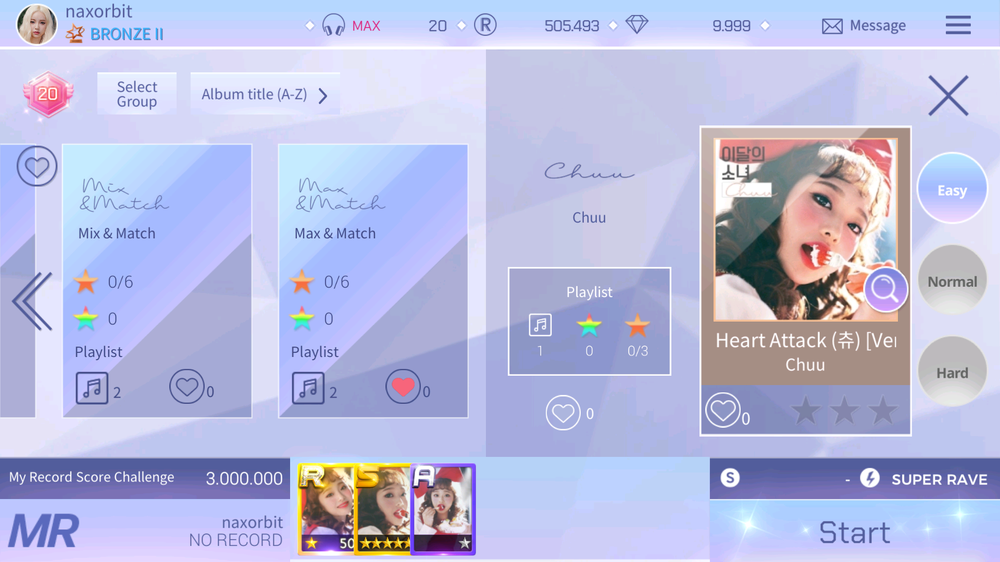
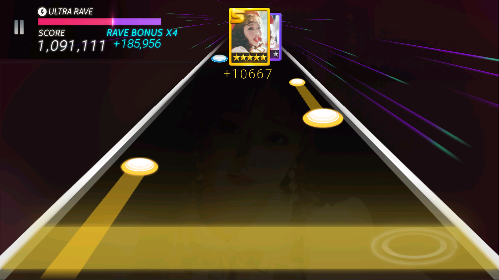
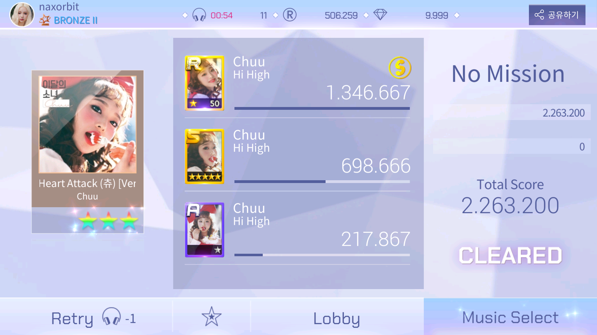
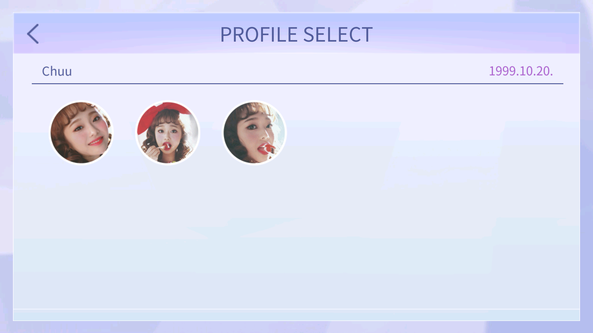

# 🌟 SuperStar LOONA Revival

> Reverse engineering, standalone offline engine preservation, and client reconstruction project for **SuperStar LOONA** (`com.dalcomsoft.sslo`), originally developed by Dalcomsoft on Unity IL2CPP.

---

## 📌 Overview

> [!IMPORTANT]
> **100% Standalone Offline Architecture (On-Device)**  
> Following the permanent shutdown of Dalcomsoft's official servers, this project converts **SuperStar LOONA** into a **fully self-contained offline game**.  
> Authentication, user profile persistence, inventory management, card upgrading/equipping, Card Book collections, music selection, rhythm gameplay, and result scoring all execute locally on-device via Frida Gadget + IL2CPP memory instrumentation (`libscript.so`) and local JSON tables—requiring **zero external servers or internet access**.

### Core Engineering Pillars

1. **On-Device Standalone Offline Engine (`app/src/main/assets/libscript.js`):**
   - Intercepts internal networking (`BestHTTP`, `URLsControl`, `WWWFile`, `AssetControl`) to resolve requests directly against local storage (`/storage/emulated/0/Android/data/com.dalcomsoft.sslo/files/`).
   - Persists full player state (`player_profile.json`, equipped cards across all 22 OT12/sub-unit/soloist groups, card levels/grades, RP, Diamonds, headphones, clear scores, favorite groups, and Lobby wallpaper).
2. **Dalcomsoft Cryptography & Data Tooling (`tools/crypto/`, `tools/deploy/`):**
   - Decodes and inspects Dalcomsoft's `.bin` configuration tables (`msd`, `cdd`, `tmd`, `gcd`, `atd`, `cbd`, `cid`, `lbg`, `prd`, `url_shared_map`, etc.) into structured JSON tables under `asiudgasg/sdisgkdc/`.
3. **IL2CPP Instrumentation & Client Patches:**
   - ARM64 / ARMv7 symbol analysis via `dump/dump.cs` (`il2cpp_runtime_invoke`, native RVA trampolines, GOT metadata patching, `libunity.so` TLS/crash shields, `libminiaudio.so` Vorbis audio sample-rate & EOF shields).
4. **Dual-Flavor Android Build (`dev` & `standalone`):**
   - Fast iterative `dev` APK (~159 MB) for emulator/ADB workflows.
   - Self-contained `standalone` APK (~823 MB) bundling **7,378** actively used game assets with automatic first-launch extraction (`StandaloneSetupActivity`)—ready to install directly on physical Android phones without `adb push`.

---

## ✅ Implemented Features & Recent Progress

- **Title & Lobby Scenes:**
  - Instant offline auto-login and `TOUCH TO START` transition into `LobbyScene`.
  - Crisp `1024x1024` wallpaper rendering (`mipChain = false`, `FilterMode.Bilinear`, `TextureWrapMode.Clamp`, `anisoLevel = 8`) with dynamic Canvas-based `1:1` cover sizing on both Title (`kswoks/bg0..bg7`) and Lobby (`weoihxd/*_l.i.bytes`).
  - Restored full left & right diamond menus including **League** and **Shop**, backed by unified native modal notices (`"Shop (Offline Mode)"` and `"League (Offline Mode)"`) across Lobby, Select Music, Inventory, Card Book, Profile Purchase, and Wallpaper Edit.
- **Inventory, Power Up & Card Book:**
  - Dynamic multi-slot rendering supporting 12-member (`[X X]`, `[+ +]`), sub-unit (`1/3`, `ODD EYE CIRCLE`, `yyxy`), and soloist groups (3–11 slots), including custom `EmptyCard` placeholders and normalized `_l` (`226x318`) / `_s` (`116x156`) tier frames.
  - Full **Equip**, **Auto Equip**, **Unequip All**, **Card Lock**, **Favorite Card**, **Power Up**, **S5 → R1 Upgrade** (up to `R50`), **Theme Exchanger**, and **Bundle Sell** with persistent **RP** and **Diamond** accounting.
  - Complete **Card Book** browsing, normal & prism views, theme/card collection point tiers (`cac.json`), and up to 5 favorite groups.
- **Rhythm Gameplay & Result Screen:**
  - Offline playback across **92 tracks** (`SelectMusicScene` → `IngameLoadingScene` → `IngameScene` → `ResultScene`), loading `.a.bytes` Vorbis audio and `.seq` beatmaps natively.
  - **Chuu Integration:** Added Chuu (`22001..22006`) across `lcd.json`, `grd.json`, `atd.json`, `tmd.json`, `cdd.json`, `prd.json`, and `msd.json`, making ***Heart Attack (츄) [Verse 1]*** playable end-to-end with Vocal/Dance/Rhythm cards, handwritten/regular logos, album cover, in-game background, and result cards.
  - Persistent high scores, rainbow clear stars, RP rewards, and authentic headphone consumption (`20/20` max, `20-minute` recharge timer persisted offline).
- **User Profile & Lobby Wallpapers:**
  - Full `My Info` and `Edit My Info` flows: nickname, status message, profile colors, Favorite Card/Theme, `76` Lobby wallpapers (`11` free base), and `329` profile avatars (including 3 distinct circular avatars for Chuu).

---

## 📸 Screenshots

| Title Screen (`TOUCH TO START`) | Lobby (`weoihxd` + League & Shop) |
| :---: | :---: |
|  |  |

| Inventory (`[X X]` OT11 R50 Equipped) | Card Book (`Chuu`) |
| :---: | :---: |
|  |  |

| Music Select (`Heart Attack - Chuu`) | Rhythm Gameplay (`IngameScene`) |
| :---: | :---: |
|  |  |

| Result Screen (`CLEARED` & RP Sync) | Profile Selector (`Chuu` Avatars) |
| :---: | :---: |
|  |  |

---

## 📁 Repository Structure

```text
├── .agents/                          # Operational rules (AGENTS.md), agent roles & specialized skills
├── app/
│   ├── build.gradle                  # Gradle config with 'dev' and 'standalone' distribution flavors
│   ├── src/
│   │   ├── main/
│   │   │   ├── assets/               # Patched libscript.js, default player_profile.json, data/, bgm/, soundfx/
│   │   │   ├── java/com/unity3d/player/
│   │   │   │   ├── StandaloneSetupActivity.java  # First-launch async zip extractor for standalone APK
│   │   │   │   └── UnityPlayerActivity.java      # Original Unity/Frida host activity
│   │   │   └── lib/                  # Native libs (arm64-v8a / armeabi-v7a: libil2cpp.so, libfrida-gadget.so, libscript.so)
│   │   └── files/                    # Decrypted local tables, cards, logos, wallpapers, audio (.a.bytes), beatmaps (.seq)
├── data/                             # Intermediate JSON card/metadata tables
├── docs/
│   ├── CONTEXT.md                    # Cumulative engineering log & reverse-engineering knowledge base
│   ├── CARDS_INTEGRATION_GUIDE.md    # Step-by-step guide to integrate new groups/themes/cards
│   ├── SONGS_INTEGRATION_GUIDE.md    # Step-by-step guide to integrate playable songs & .seq charts
│   └── walkthroughs/                 # Chronological milestone reports and screenshots (media/)
├── dump/                             # Il2CppDumper outputs (dump.cs, il2cpp.h, script.json, DummyDll/)
├── server/                           # Legacy Python mock server (development/research reference)
├── tools/
│   ├── crypto/decrypt_dalcom.py      # Dalcomsoft .bin encryption/decryption CLI
│   ├── deploy/
│   │   ├── build_standalone_assets.py # Selective standalone APK packager (filters unused assets & signs APK)
│   │   ├── deploy_card_assets.py     # ADB tar sync for card/book/UI textures
│   │   └── deploy_music_assets.py    # ADB tar sync for songs, beatmaps, covers & in-game backgrounds
│   └── ...                           # Auditing, database generation & patching scripts
├── build.gradle
├── gradle.properties
└── settings.gradle
```

---

## 🛠️ Prerequisites & Build Guide

### Requirements
- **Android SDK & Build Tools** (`adb`, `zipalign`, `apksigner` configured in `local.properties`)
- **Gradle 8.7** & **JDK 17+**
- **Python 3.10+** (for asset sync and packaging scripts)
- **Supported Android ABIs:** `arm64-v8a` & `armeabi-v7a` (`minSdk 24` / Android 7.0+)

### Option A: Self-Contained Mobile APK (`standalone` — No `adb push` Needed)

Builds `app-dev-debug.apk`, packages only the **7,378 active assets** (excluding ~625 MB of unused online store/event/raw assets and macOS metadata, without POSIX symlinks for FUSE/sdcardfs compatibility), aligns, and debug-signs the mobile APK:

```bash
gradle assembleDevDebug
python3 tools/deploy/build_standalone_assets.py --package-apk
```

Output: `app/build/outputs/apk/standalone/debug/app-standalone-debug.apk` (~823 MB).  
Install directly on a physical device or emulator—on first launch, `StandaloneSetupActivity` extracts assets once into `Android/data/com.dalcomsoft.sslo/files/` while preserving any existing `player_profile.json`.

### Option B: Fast Developer Workflow (`dev` + ADB Asset Sync)

```bash
gradle assembleDevDebug
adb install -r app/build/outputs/apk/dev/debug/app-dev-debug.apk
python3 tools/deploy/deploy_card_assets.py
python3 tools/deploy/deploy_music_assets.py
```

---

## 🔐 Dalcomsoft Data Cryptography

Configuration tables in `app/src/files/asiudgasg/sdisgkdc/*.bin` use Dalcomsoft's AES-128-CBC binary serialization format:

```bash
# Decrypt binary table to editable JSON
python3 tools/crypto/decrypt_dalcom.py decrypt app/src/files/asiudgasg/sdisgkdc/msd.bin msd.json

# Re-encrypt modified JSON back to .bin
python3 tools/crypto/decrypt_dalcom.py encrypt msd.json msd.bin
```

For adding new artists, cards, and playable tracks, see:
- [docs/CARDS_INTEGRATION_GUIDE.md](docs/CARDS_INTEGRATION_GUIDE.md)
- [docs/SONGS_INTEGRATION_GUIDE.md](docs/SONGS_INTEGRATION_GUIDE.md)

---

## 🤖 AI Agent Guidelines

This repository enforces structured multi-agent workflows documented in:
- [.agents/AGENTS.md](.agents/AGENTS.md) — Mandatory operating rules, Git checkpoints, and continuous updates to `docs/CONTEXT.md`.
- [.agents/skills/](.agents/skills/) — Specialized domain playbooks (Dalcomsoft reversing, decryption, network bypass, QA automation, Conventional Commits).

---

## ⚖️ Legal Notice & Intellectual Property

This project is strictly for educational, software preservation, and reverse-engineering research purposes.

- All visual assets, audio tracks, trademarks, and copyrights belong to **Dalcomsoft Inc.** and the respective artists/agencies (**Blockberry Creative**, **MODHAUS**).
- No commercial use or monetization is intended.
