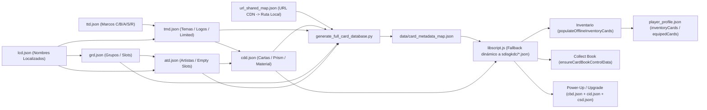

# Guía Técnica: Integración de Nuevas Cartas, Temas, Artistas y Grupos

Esta guía documenta el proceso completo para agregar nuevas cartas (normales, prismáticas y materiales `%`), temas, artistas y grupos en el cliente offline standalone de **SuperStar LOONA** (`com.dalcomsoft.sslo`), cubriendo tablas de datos, texturas, **Collect Book (CardBook)**, **Inventario**, **Power-Up / Level Up / Grade Up (Upgrade)**, **Theme Exchanger** y **Gameplay**.

---

## 1. Arquitectura General y Flujo de Datos



### Rutas Clave en el Repositorio y Dispositivo
- **Tablas maestras (`.bin` y `.json`):** [app/src/files/asiudgasg/sdisgkdc/](file:///Users/ignaciorojas/Documents/repos/sslo_apk/app/src/files/asiudgasg/sdisgkdc)
- **Índice compilado de cartas/temas:** [app/src/main/assets/data/card_metadata_map.json](file:///Users/ignaciorojas/Documents/repos/sslo_apk/app/src/main/assets/data/card_metadata_map.json)
- **Motor offline JS (Frida/Hook):** [app/src/main/assets/libscript.js](file:///Users/ignaciorojas/Documents/repos/sslo_apk/app/src/main/assets/libscript.js) (sincronizado con `libscript.so` en `arm64-v8a` y `armeabi-v7a`)
- **Encriptación / Desencriptación `.bin`:** [tools/crypto/decrypt_dalcom.py](file:///Users/ignaciorojas/Documents/repos/sslo_apk/tools/crypto/decrypt_dalcom.py) (AES-256-ECB, clave `WnFKN1v_gUcgmUVZnjjjGXGwk557zBSO`, Base64 + GZip)
- **Generador de base de cartas:** [tools/generate_full_card_database.py](file:///Users/ignaciorojas/Documents/repos/sslo_apk/tools/generate_full_card_database.py)
- **Despliegue de texturas a Android:** [tools/deploy/deploy_card_assets.py](file:///Users/ignaciorojas/Documents/repos/sslo_apk/tools/deploy/deploy_card_assets.py)
- **Ruta raíz en dispositivo:** `/storage/emulated/0/Android/data/com.dalcomsoft.sslo/files/`

---

## 2. Convenciones de IDs y Rangos Libres

| Entidad | Tabla | Rango Oficial Actual | Rango Recomendado para Nuevo Contenido |
| :--- | :--- | :--- | :--- |
| **Cartas jugables** | [cdd.json](file:///Users/ignaciorojas/Documents/repos/sslo_apk/app/src/files/asiudgasg/sdisgkdc/cdd.json) | `1001 .. 21012` | `22001 .. 29999` o `31001+` |
| **Cartas material (%)** | `cdd.json` (`material: 1`) | `30001 .. 30005` | `30006 .. 30099` |
| **Temas** | [tmd.json](file:///Users/ignaciorojas/Documents/repos/sslo_apk/app/src/files/asiudgasg/sdisgkdc/tmd.json) | `1001 .. 21002` | `22001+` (o correlativo dentro de grupo existente, ej. `1010+`) |
| **Artistas** | [atd.json](file:///Users/ignaciorojas/Documents/repos/sslo_apk/app/src/files/asiudgasg/sdisgkdc/atd.json) | `1001 .. 21006` | Usar `artistID` existente del grupo o `22001+` para grupo nuevo |
| **Grupos / Unidades** | [grd.json](file:///Users/ignaciorojas/Documents/repos/sslo_apk/app/src/files/asiudgasg/sdisgkdc/grd.json) | `1001 .. 21002` | Múltiplo `X001` (`22001`, `23001`, ..., `< 30000`) |

> [!NOTE]
> [libscript.js](file:///Users/ignaciorojas/Documents/repos/sslo_apk/app/src/main/assets/libscript.js) y [generate_full_card_database.py](file:///Users/ignaciorojas/Documents/repos/sslo_apk/tools/generate_full_card_database.py) ya permiten cualquier `cardID >= 1001` sin tope superior rígido en inventario y detectan automáticamente nuevos grupos base `>= 22001` (`code % 1000 == 1`, `code < 30000`) definidos en `grd.json`.

---

## 3. Tablas JSON que Debes Editar

### 3.1. Si creas un Grupo Nuevo: `grd.json` (`GroupData`)
Agrega una entrada en [grd.json](file:///Users/ignaciorojas/Documents/repos/sslo_apk/app/src/files/asiudgasg/sdisgkdc/grd.json) (y registra su `localeName` en [lcd.json](file:///Users/ignaciorojas/Documents/repos/sslo_apk/app/src/files/asiudgasg/sdisgkdc/lcd.json)):

```json
{
  "code": 22001,
  "analyticsData": "NewUnit",
  "groupType": 1,
  "equipableSlot": 4,
  "localeName": 10000022,
  "profileGroupName": 10060022,
  "cardLocaleName": 10070022,
  "integrateCode": null,
  "emblemImage": "http://d3exy8s96shf22.cloudfront.net/resources/custom/emblem_newunit.png?v=26112701",
  "bestCardbookImage": "http://d3exy8s96shf22.cloudfront.net/resources/custom/cardbook_mybg_newunit.png?v=26112701",
  "orderIndex": 21,
  "secondOrderIndex": 21,
  "displayStartAt": null,
  "displayEndAt": null
}
```
- `equipableSlot`: número de cartas equipables (debe coincidir con la cantidad de artistas del grupo en `atd.json`).
- **Importante:** no incluyas `"(Event)"` en `analyticsData` para grupos base jugables, así `generate_full_card_database.py` los incluirá en `playableGroups`.

### 3.2. Si agregas Artistas / Slots Vacíos: `atd.json` (`ArtistData`)
Si usas un grupo existente (`1001` LOONA tiene artistas `1001..1011`), reutiliza sus `artistID`. Si agregas nuevos integrantes en [atd.json](file:///Users/ignaciorojas/Documents/repos/sslo_apk/app/src/files/asiudgasg/sdisgkdc/atd.json):

```json
{
  "code": 22001,
  "group": 22001,
  "analyticsData": "NewUnit_Member1",
  "artistType": 1,
  "orderIndex": 0,
  "localeName": 10000221,
  "emptyImageSmall": "http://d3exy8s96shf22.cloudfront.net/resources/custom/c_s_newunit_m1_em.png?v=26112701",
  "emptyImageLarge": "http://d3exy8s96shf22.cloudfront.net/resources/custom/c_l_newunit_m1_em.png?v=26112701",
  "profileImage": "http://d3exy8s96shf22.cloudfront.net/resources/custom/p_newunit_m1.png?v=26112701",
  "nameImage": "http://d3exy8s96shf22.cloudfront.net/resources/custom/artistname_m1.png?v=26112701",
  "isProfileImage": true,
  "bonusBirthdayUse": false
}
```

### 3.3. Crear el Tema: `tmd.json` (`ThemeData`) + Marcos `ttd.json`
Agrega el tema en [tmd.json](file:///Users/ignaciorojas/Documents/repos/sslo_apk/app/src/files/asiudgasg/sdisgkdc/tmd.json):

```json
{
  "code": 22001,
  "analyticsData": "[+ +]_CustomTheme",
  "localeName": 10012201,
  "nameImageSmall": "http://d3exy8s96shf22.cloudfront.net/resources/custom/theme_s_custom.png?v=26112701",
  "nameImageLarge": "http://d3exy8s96shf22.cloudfront.net/resources/custom/theme_l_custom.png?v=26112701",
  "nameImageZoom": null,
  "limitedType": 0,
  "themeTypeCode": 0,
  "themePercentage": 20,
  "selectRate": 1.0,
  "orderIndex": 99,
  "rehearsalTheme": false,
  "cardbookMarkCode": "[904]",
  "effectType": 0,
  "specialType": null
}
```
- `limitedType`: `0` = Normal, `1` = Limited (badge `901`), `2` = Event (badge `902`). `cardbookMarkCode` soporta `[901]`, `[902]`, `[903]` (Original) o `[904]`.
- `themeTypeCode`: referencia a [ttd.json](file:///Users/ignaciorojas/Documents/repos/sslo_apk/app/src/files/asiudgasg/sdisgkdc/ttd.json) (`0` = marco clásico básico C/B/A/S/R; valores distintos definen bordes personalizados en `aoeiwhslc/uhex/`).

### 3.4. Registrar cada Carta: `cdd.json` (`CardData`)
Por cada integrante del tema y cada variante (`type: 0` Normal, y opcionalmente `type: 1` Prism), agrega una entrada en [cdd.json](file:///Users/ignaciorojas/Documents/repos/sslo_apk/app/src/files/asiudgasg/sdisgkdc/cdd.json):

```json
{
  "code": 22001,
  "groupID": 1001,
  "artistID": 1001,
  "theme": 22001,
  "type": 0,
  "material": 0,
  "intensifyPercentage": 0,
  "percentage": 1.0,
  "isSelect": true,
  "myStoreAppear": true,
  "cardImageSmall": "http://d3exy8s96shf22.cloudfront.net/resources/custom/c_s_custom_heejin.png?v=26112701",
  "cardImageLarge": "http://d3exy8s96shf22.cloudfront.net/resources/custom/c_l_custom_heejin.png?v=26112701",
  "prism": null,
  "zoomUpCardImage": null,
  "zoomUpCardVideo": null,
  "zoomUpCardVideoUnlock": null
}
```
- **Regla Normal vs Prism:** la versión normal usa `type: 0` y su contraparte Prism lleva otro `code` con `type: 1` (mismo `groupID`, `artistID` y `theme`).
- **Regla Carta Material `%`:** usa `material: 1`, `intensifyPercentage` (`10`, `30`, `50`, `70`, `100`), `isSelect: false`, `myStoreAppear: false`.

### 3.5. Mapeo de URLs Locales: `url_shared_map.json` y `lcd.json`
1. En [lcd.json](file:///Users/ignaciorojas/Documents/repos/sslo_apk/app/src/files/asiudgasg/sdisgkdc/lcd.json), agrega los códigos usados en `localeName` (campos `enUS`, `koKR`, `esES`, etc.).
2. En [url_shared_map.json](file:///Users/ignaciorojas/Documents/repos/sslo_apk/app/src/files/asiudgasg/sdisgkdc/url_shared_map.json), mapea cada URL exacta de `cdd.json`, `tmd.json`, `atd.json` y `grd.json` (incluyendo `?v=...`) hacia su ruta local relativa bajo `asiudgasg/`:

```json
{
  "http://d3exy8s96shf22.cloudfront.net/resources/custom/c_s_custom_heejin.png?v=26112701": "asodhsg/wadceg/22001_s.i.bytes",
  "http://d3exy8s96shf22.cloudfront.net/resources/custom/c_l_custom_heejin.png?v=26112701": "asodhsg/wadceg/22001_l.i.bytes",
  "http://d3exy8s96shf22.cloudfront.net/resources/custom/theme_s_custom.png?v=26112701": "asodhsg/agewfcbxhaa/22001_s.i.bytes",
  "http://d3exy8s96shf22.cloudfront.net/resources/custom/theme_l_custom.png?v=26112701": "asodhsg/agewfcbxhaa/22001_l.i.bytes"
}
```

---

## 4. Texturas Requeridas y Formatos Verificados

Todas las imágenes de cartas son **PNG estándar RGBA** almacenadas sin extensión `.png` bajo `.i.bytes` (y opcionalmente un symlink `.i.bytes.png -> .i.bytes` generado automáticamente al desplegar).

| Recurso | Carpeta bajo `app/src/files/asiudgasg/asodhsg/` | Nombre de Archivo | Dimensiones (px) | Formato |
| :--- | :--- | :--- | :---: | :--- |
| Carta jugable (Chica) | `wadceg/` | `<cardCode>_s.i.bytes` | `85 × 120` | PNG RGBA |
| Carta jugable (Grande) | `wadceg/` | `<cardCode>_l.i.bytes` | `226 × 318` | PNG RGBA |
| Slot vacío CardBook (Chica) | `sdhgauwehdnu/` | `<artistCode>_s.i.bytes` | `85 × 120` | PNG RGBA |
| Slot vacío CardBook (Grande) | `sdhgauwehdnu/` | `<artistCode>_l.i.bytes` | `226 × 318` | PNG RGBA |
| Logo de Tema (Chico) | `agewfcbxhaa/` | `<themeCode>_s.i.bytes` | `149 × 22` | PNG RGBA |
| Logo de Tema (Grande) | `agewfcbxhaa/` | `<themeCode>_l.i.bytes` | `233 × 45` | PNG RGBA |
| Emblema de Grupo | `aweoijs/` | `<baseGroupCode>.i.bytes` | `86 × 86` | PNG RGBA |
| Fondo Best CardBook | `foewghkc/` | `<baseGroupCode>.i.bytes` | (opcional si es grupo nuevo) | PNG |

> [!WARNING]
> Verifica siempre que `_s.i.bytes` (`85x120`) y `_l.i.bytes` (`226x318`) no queden invertidos y que las rutas en `asodhsg/` no sean symlinks rotos: `loadLocalTexture2D` valida existencia real del destino con `access(..., F_OK)`.

---

## 5. Cómo se Integran en Cada Sistema del Juego

### 5.1. Collect Book (`CardBook`)
- **Registro automático de catálogo:** Al cargar `card_metadata_map.json` (o caer al lector directo de `cdd.json`/`tmd.json`/`grd.json`/`atd.json` en `libscript.js`), `ensureThemeArtistCardMap()` indexa `theme + "_" + artistID -> cardCode` (normal) y `themeArtistPrismCardMap` (prism), y `ensureCardBookControlData()` construye cada pestaña `CardBookControl/ThemeItem` del grupo con los `artistCodes` ordenados.
- **Estado obtenido vs vacío (`IsViewCard`):**
  - `syncAccountOwnedCards()` lee `profile.inventoryCards`.
  - Si el jugador **aún no posee** `cardCode`, `URLsControl.SetCdnTexture` (`0x163A9E8`) resuelve la textura vacía desde `sdhgauwehdnu/<artistCode>_{s,l}.i.bytes`.
  - Si **ya posee** al menos una copia en `inventoryCards`, se desbloquea su retrato real de `wadceg/<cardCode>_{s,l}.i.bytes` y registra el **grado más alto obtenido**.
- **Puntos de Colección (`cgd.json` y `cac.json`):**
  - [cgd.json](file:///Users/ignaciorojas/Documents/repos/sslo_apk/app/src/files/asiudgasg/sdisgkdc/cgd.json): `C = 1`, `B = 2`, `A = 3`, `S = 4`, `R = 0` (`cardBookValue`) según el grado más alto desbloqueado de la carta.
  - [cac.json](file:///Users/ignaciorojas/Documents/repos/sslo_apk/app/src/files/asiudgasg/sdisgkdc/cac.json): define los niveles `1..100` (`pointValue` y recompensas) usando esos puntos acumulados.
- **Badges de CardBook:** `getOrCreateThemeData()` lee `limitedType` (`1 -> 901 Limited`, `2 -> 902 Event`) y `cardbookMarkCode` (`[901..903]`) dinámicamente sin editar `libscript.js`.

### 5.2. Inventario (`InventoryScene` / `player_profile.json`)
> [!IMPORTANT]
> La Tienda (`StorePopup.Open` `0xB6EE4C`) muestra aviso offline en la versión actual, por lo que la vía oficial para otorgar nuevas cartas a una cuenta es `player_profile.json` (`inventoryCards`), ya sea editando el JSON o al regenerarlo con [generate_full_card_database.py](file:///Users/ignaciorojas/Documents/repos/sslo_apk/tools/generate_full_card_database.py).

Estructura de cada instancia en `player_profile.json` -> `inventoryCards`:
```json
{
  "objectID": 105001,
  "cardID": 22001,
  "grade": 2,
  "level": 1,
  "energy": 40,
  "score": 40,
  "isEquip": false,
  "isLock": false,
  "isPrism": false,
  "themeID": 22001,
  "groupID": 1001,
  "artistID": 1001
}
```
- **`objectID`**: entero único de instancia (no repetir entre cartas del jugador).
- **`grade`**: `0=C`, `1=B`, `2=A`, `3=S`, `4=R`.
- **`level`**: `1..5` (grados `C..S`) o `1..50` (grado `R`).
- **`equipedCards`**: si marcas `isEquip: true`, agrega también ese `objectID` en `equipedCards["<groupID>"]` (respetando el máximo `equipableSlot` del grupo y 1 carta por `artistID`).
- **Orden y filtros automáticos:** `populateOfflineInventoryCards()` calcula `sortCardIndex = gCode * 10000 + (tCode % 100) * 100 + memberIdx` y crea `CardItem` + `InventoryControl.GroupItem` para cada grupo en `playableGroups`.

### 5.3. Power-Up, Level Up, Upgrade y Venta
Una carta registrada en `cdd.json` / `card_metadata_map.json` hereda automáticamente todo el sistema de mejora sin configuración extra:
1. **Estadísticas Base (`cbd.json`):**
   - `C..S`: `cbdCode = grade * 5 + (level - 1)` (`0..19`).
   - `R`: `cbdCode = 20 + (level - 1)` (`20..69` para `R1..R50`).
   - Si `isPrism: true`, suma **`+10`** (`prizmScore`) sobre `score`.
2. **Power-Up (`C1..S5`) y Level Up (`R1..R50`) (`cid.json`):**
   - Hasta **5 cartas material** en `InvenCardIntensifyView`.
   - `getIntensifyPriceAndRate()` consulta `cid.json` por `(targetGrade, targetLevel)` vs cada `(matGrade, matLevel)` para costo en RP (`93..225 RP`) y probabilidad (`Rate`).
   - Las cartas material `%` (`material: 1`) aplican directamente `intensifyPercentage` como tasa de éxito.
   - Si una carta material del mismo `groupID` tiene éxito o es consumida, se elimina de `inventoryCards` en `player_profile.json`.
3. **Grade Up / Upgrade (`C5→B1`, `B5→A1`, `A5→S1`, `S5→R1`):**
   - Cuando `targetGrade < 4 && targetLevel >= 5`, el botón cambia a **Upgrade** (`100%` garantizado, `1` material requerido).
   - **Condición estricta del material:** debe compartir **exactamente el mismo `artistID`** (puede ser de distinto tema del mismo integrante), tener **el mismo `grade`** y **`level >= 5`**.
   - Costos verificados: `C→B = 2,500 RP`, `B→A = 5,000 RP`, `A→S = 10,000 RP`, `S→R = 20,000 RP` (o valor en `cid.json`).
4. **Venta (`csd.json`):** `C=200`, `B=600`/`400`, `A=1200`/`600`, `S=1800`/`800`, `R=2400`/`1200` (según `csd.json` con fallback en `getCardSellPrice`).
5. **Theme Exchanger:** permite rotar entre temas normales (`limitedType === 0`) del mismo `groupID` y `artistID` siempre que existan al menos 2 temas normales cargados en `meta.groups[gId].themeCodes`.

### 5.4. Gameplay y Puntaje Ingame
- Al iniciar una canción en `SelectMusicScene`, se equipa automáticamente la formación de `equipedCards[groupData]`.
- **Bonus de Grado Inicial ([cgd.json](file:///Users/ignaciorojas/Documents/repos/sslo_apk/app/src/files/asiudgasg/sdisgkdc/cgd.json)):** promedio de `abilityValue` (`10,000 .. 100,000`), llegando hasta `+500,000` puntos iniciales cuando todo el deck es grado R.
- **Theme Bonus:** si múltiples slots equipados comparten el mismo `theme` (`tmd.json`), el juego activa `Theme Bonus` Lv 1..3 incrementando puntos por nota según `themePercentage` (`20%`).

---

## 6. Procedimiento Paso a Paso de Despliegue y Verificación

1. **Editar tablas JSON** en [app/src/files/asiudgasg/sdisgkdc/](file:///Users/ignaciorojas/Documents/repos/sslo_apk/app/src/files/asiudgasg/sdisgkdc) (`cdd.json`, `tmd.json`, opcionalmente `atd.json`/`grd.json`, `lcd.json`, `url_shared_map.json`).
2. **Opcional — re-encriptar a `.bin`** para mantener paridad exacta con las tablas binarias del cliente:
   ```bash
   python3 tools/crypto/decrypt_dalcom.py encrypt app/src/files/asiudgasg/sdisgkdc/cdd.json -o app/src/files/asiudgasg/sdisgkdc/cdd.bin
   python3 tools/crypto/decrypt_dalcom.py encrypt app/src/files/asiudgasg/sdisgkdc/tmd.json -o app/src/files/asiudgasg/sdisgkdc/tmd.bin
   ```
3. **Regenerar `card_metadata_map.json`** (respalda tu `player_profile.json` antes si no deseas regenerar la cuenta starter):
   ```bash
   cp app/src/main/assets/player_profile.json /tmp/backup_profile.json
   python3 tools/generate_full_card_database.py
   cp /tmp/backup_profile.json app/src/main/assets/player_profile.json
   ```
4. **Copiar las texturas PNG** con extensión `.i.bytes.png` (o `.i.bytes`) a `app/src/files/asiudgasg/asodhsg/{wadceg,sdhgauwehdnu,agewfcbxhaa,aweoijs}/`.
5. **Desplegar assets y datos en BlueStacks / Android:**
   ```bash
   python3 tools/deploy/deploy_card_assets.py
   adb -s 127.0.0.1:5555 push app/src/main/assets/data/card_metadata_map.json /sdcard/Android/data/com.dalcomsoft.sslo/files/data/card_metadata_map.json
   adb -s 127.0.0.1:5555 push app/src/files/asiudgasg/sdisgkdc/ /sdcard/Android/data/com.dalcomsoft.sslo/files/asiudgasg/sdisgkdc/
   ```
6. **Validar en el emulador (`adb logcat -s FridaSSLO`):**
   - Abrir **CardBook**: confirmar pestaña del tema, emblema sin candado, slot vacío si no se posee o retrato si se posee.
   - Abrir **Inventory**: confirmar tarjeta visible, detalle grande `_l`, ordenamiento por grupo/artista/grado.
   - Probar **Power-Up / Upgrade**: verificar costo en RP, tasa de éxito y actualización persistente en `player_profile.json`.
   - Jugar una canción del mismo `groupID`: verificar retrato en HUD superior y suma de `Theme Bonus`.
