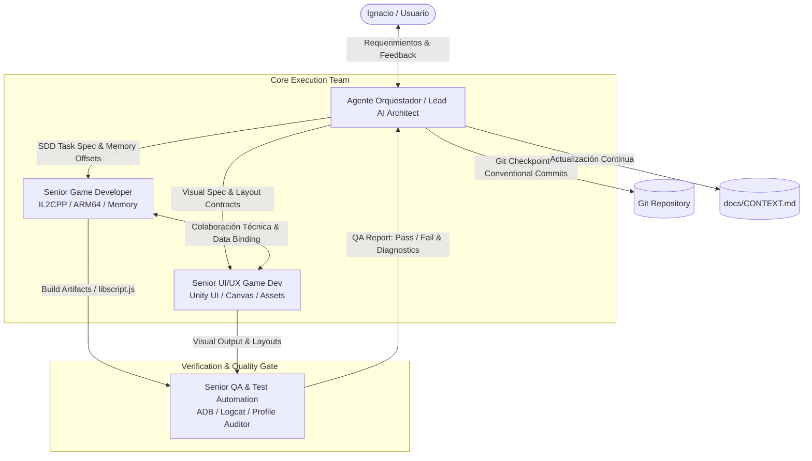

# Software Design Description (SDD): Arquitectura Multi-Agente para SuperStar LOONA Revival

**Documento ID:** SDD-SLR-MAS-001  
**Versión:** 1.0.0  
**Fecha:** 2026-09-29  
**Autor:** Antigravity (Lead AI Systems Architect)  
**Proyecto:** SuperStar LOONA Revival (`com.dalcomsoft.sslo`)  
**Metodología:** Specification-Driven Development (SDD) / Multi-Agent Hierarchical Orchestration  

---

## 1. Introducción y Propósito

El propósito de este documento de diseño de software (SDD) es establecer la arquitectura, topología, contratos de comunicación y contextos mínimos viables para un **Sistema Multi-Agente (MAS)** de alta precisión enfocado en la ingeniería inversa, desarrollo offline, refinamiento visual y aseguramiento de calidad de **SuperStar LOONA** (Unity IL2CPP / ARM64).

La arquitectura desacopla el ciclo de vida del desarrollo en **roles especializados**, coordinados por un **Agente Orquestador Central**, eliminando alucinaciones, sobrecarga de contexto en la ventana de atención (token bloat) y garantizando que cada intervención cumpla con estrictos estándares de ingeniería de software.

---

## 2. Topología y Modelo de Interacción

El sistema implementa el patrón **Hierarchical Orchestrator-Workers with Quality Gate**:

---

## 3. Matriz de Responsabilidades (RACI)

| Rol / Agente | Orquestación & Git | IL2CPP & Memoria | UI/UX & Canvas | QA & Verificación | CONTEXT.md |
| :--- | :---: | :---: | :---: | :---: | :---: |
| **Lead AI Orchestrator** | **A / R** | I | I | A | **A / R** |
| **Senior Game Dev** | C | **R** | C | C | C |
| **Senior UI/UX Dev** | C | C | **R** | C | C |
| **Senior QA Tester** | C | I | I | **R** | C |

*Leyenda: **R** = Responsable (Responsible), **A** = Aprobador/Responsable Final (Accountable), **C** = Consultado (Consulted), **I** = Informado (Informed).*

---

## 4. Definición de Agentes y Contextos Mínimos Viables (MVC)

### 4.1. Agente Orquestador (Lead AI Architect)
* **Objetivo:** Planificar, desglosar, asignar y auditar el ciclo de vida completo de cada tarea solicitada por Ignacio.
* **Contexto Mínimo Viable (MVC):**
  - **Archivos Fuente:** [docs/CONTEXT.md](file:///Users/ignaciorojas/Documents/repos/sslo_apk/docs/CONTEXT.md), [.agents/AGENTS.md](file:///Users/ignaciorojas/Documents/repos/sslo_apk/.agents/AGENTS.md), [README.md](file:///Users/ignaciorojas/Documents/repos/sslo_apk/README.md).
  - **Directrices Obligatorias:**
    1. Saludar siempre a **Ignacio** por su nombre al iniciar la interacción.
    2. Ejecutar commits de checkpoint en Git bajo *Conventional Commits* antes y después de cada cambio estructural.
    3. Mantener `docs/CONTEXT.md` como la única fuente de verdad técnica acumulativa.
    4. Garantizar que ningún cambio sea aprobado sin el visto bueno formal del **Senior QA Tester**.

---

### 4.2. Sub-Agente 1: Senior Game Developer (IL2CPP / Memory / Dalcom Engine)
* **Objetivo:** Instrumentar en memoria `libil2cpp.so` mediante Frida Gadget (`libscript.js`), manipular estructuras de datos nativas y gobernar la persistencia offline en el cliente sin requerir servidores remotos.
* **Contexto Mínimo Viable (MVC):**
  - **Ruta de Script:** [app/src/main/assets/libscript.js](file:///Users/ignaciorojas/Documents/repos/sslo_apk/app/src/main/assets/libscript.js)
  - **Archivo de Persistencia:** `/storage/emulated/0/Android/data/com.dalcomsoft.sslo/files/player_profile.json`
  - **RVAs y Offsets Críticos:**
    - `InventoryScene.OnOpen`: RVA `0x1051604`
    - `InventoryScene.SetStateDefault`: RVA `0x1053B88`
    - `InventoryScene.OnChange`: RVA `0x105A61C`
    - `InventoryScene.OnEquip`: RVA `0x105AFC8`
    - `InventoryControl.Equip`: RVA `0xF2C374`
    - `InventoryControl.Unequip`: RVA `0xF2C5E4`
    - `SceneControl.OpenScene`: RVA `0xD534BC`
    - `InventoryScene` Offsets: `sceneView` (`+0x48`), `displayCardList` (`+0x58`), `selectedCardItem` (`+0x88`), `equippedCardItem` (`+0x90`).
  - **Reglas Negativas (Restricciones Críticas):**
    - PROHIBIDO llamar a `GameObject.SetActive` en vistas secundarias (`mainView`, `selectView`); se debe usar el gestor de layout nativo (`ShowMainLayout`, `ShowDefaultLayout`, `ShowEquipLayout`).
    - PROHIBIDO pasar memoria nativa sin inicializar de Frida (`Memory.alloc`) a campos inspeccionados por el Garbage Collector de Unity (evita `SIGSEGV` en `0x9F8DE0`).
    - Escribir `NULL` en el offset `+0x48` de `InvenCardSelectView.Params` para evitar la violación de acceso `0x132` de `GetCardThemeInfoViewData`.

---

### 4.3. Sub-Agente 2: Senior UI/UX Game Developer (Visual / Layout / Asset Pipeline)
* **Objetivo:** Garantizar excelencia visual gráfica (Retina ready), alineación canónica de componentes de interfaz, renderizado de marcos y tipografías oficiales, y erradicación de quads blancos o parpadeos.
* **Contexto Mínimo Viable (MVC):**
  - **Ubicación de Assets:**
    - Fondos de Lobby: `app/src/files/asiudgasg/asodhsg/weoihxd/` (1024x1024 RGBA con viñeteado).
    - Marcos de Rango: `app/src/files/asiudgasg/asodhsg/aoeiwhslc/uhex/` (116x156 px, variantes `_s`, `_c`, `_l`).
    - Retratos de Integrantes: `app/src/files/asiudgasg/asodhsg/wadceg/` (`_s` 85x120 px, `_l` 226x318 px).
    - Siluetas Vacías: `app/src/files/asiudgasg/asodhsg/sdhgauwehdnu/` (`<id>_l.i.bytes`).
  - **RVAs y Funciones de Renderizado:**
    - `Texture2D..ctor(int, int)`: RVA `0x181B6BC`
    - `ImageConversion.LoadImage(tex, bytes, NULL)`: RVA `0x25B3E90`
    - `Texture.set_filterMode(2)`: RVA `0x181A580` (Trilinear obligatorio)
    - `Texture.set_anisoLevel(8)`: RVA `0x181A640`
    - `RawImage.set_texture`: RVA `0x194C074`
    - `Graphic.SetNativeSize`: RVA `0x1949574`
  - **Reglas de Diseño:**
    - Para cartas no-R (C, B, A, S), acotar siempre el nivel a $[1, 5]$ con `maxLevel = 5` para cargar los sprites dorados oficiales y erradicar los rectángulos blancos.
    - Mantener alineación canónica OT11 desactivando cualquier slot $i \ge 11$ en la cuadrícula de LOONA.
    - Asegurar que `autoSize !== 0` invoque `SetNativeSize()` para centrar marcos de 116x156 sobre retratos de 85x120.

---

### 4.4. Sub-Agente 3: Senior QA & Test Automation Engineer (Quality Gate)
* **Objetivo:** Validar experimentalmente la solidez de cada implementación en dispositivo o emulador Android (BlueStacks) mediante pruebas no intrusivas, capturas de pantalla de regresión y auditoría de archivos de datos.
* **Contexto Mínimo Viable (MVC):**
  - **Dispositivo Objetivo:** Android ARM64 (`127.0.0.1:5555`).
  - **Comandos Clave de Verificación:**
    - Inyección de Comandos: `adb shell "echo <cmd> > /storage/emulated/0/Android/data/com.dalcomsoft.sslo/files/scene_cmd.txt"`
    - Toques Táctiles: `adb shell input tap <X> <Y>`
    - Capturas de Regresión: `adb shell screencap -p /sdcard/screen.png && adb pull /sdcard/screen.png docs/walkthroughs/media/<nombre>.png`
    - Monitoreo de Logs: `adb logcat -d | grep "FridaSSLO"`
    - Auditoría de Integridad: `adb shell cat /storage/emulated/0/Android/data/com.dalcomsoft.sslo/files/player_profile.json`
  - **Criterios de Aceptación (Quality Gate Checklist):**
    1. Cero crashes nativos (`SIGSEGV`, `tombstone`, `Unity abort`).
    2. Fluidez a 60 FPS sin bloqueos en el hilo principal de renderizado.
    3. Consistencia total entre la interfaz de usuario y el archivo local `player_profile.json`.
    4. Bidireccionalidad comprobada en flujos de equipamiento / desequipamiento.

---

## 5. Protocolo de Ciclo de Vida SDD (SDD Execution Protocol)

Cada nueva iniciativa sigue estrictamente las 5 fases del protocolo SDD:

1. **Fase 1: Especificación SDD (Orchestrator):**
   - Análisis del requerimiento de Ignacio.
   - Creación de la especificación técnica en `docs/` o artefacto temporal.
   - Generación de commit de checkpoint en Git (`chore(checkpoint): ...`).
2. **Fase 2: Implementación de Lógica y Memoria (Senior Game Dev):**
   - Intercepción de funciones nativas IL2CPP en `app/src/main/assets/libscript.js`.
   - Gestión de punteros, FastArrays y persistencia en `player_profile.json`.
3. **Fase 3: Refinamiento Gráfico y UI (Senior UI/UX Dev):**
   - Vinculación de texturas HD, filtros trilineares, corrección de layouts y tipografías.
4. **Fase 4: Auditoría y Verificación Automatizada (Senior QA Tester):**
   - Ejecución de comandos táctiles en emulador.
   - Captura de pantalla en `docs/walkthroughs/media/`.
   - Inspección de `logcat` y validación de `player_profile.json`.
   - Emisión del *QA Sign-off Report*.
5. **Fase 5: Documentación y Commit Final (Orchestrator):**
   - Incorporación de los hallazgos en `docs/CONTEXT.md`.
   - Creación/actualización del walkthrough cronológico en `docs/walkthroughs/`.
   - Commit semántico bajo Conventional Commits y presentación a Ignacio.
