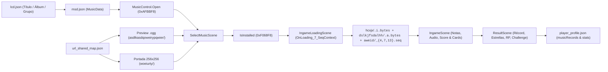

# Guía Técnica: Integración de Nuevas Canciones, Audio y Beatmaps (`.seq`)

Esta guía documenta paso a paso cómo agregar nuevas canciones jugables al cliente offline standalone de **SuperStar LOONA** (`com.dalcomsoft.sslo`), cubriendo catálogo (`msd.json`), textos (`lcd.json`), audio Ogg Vorbis (`.a.bytes`), beatmaps binarios (`.seq`), portadas, fondos ingame, registros de instalación (`url_shared_map.json` / `url_version.json`), selección musical y resultados (`ResultScene`).

---

## 1. Flujo Completo de una Canción en el Motor



### Rutas Clave en el Repositorio y Dispositivo
- **Catálogo musical:** [app/src/files/asiudgasg/sdisgkdc/msd.json](file:///Users/ignaciorojas/Documents/repos/sslo_apk/app/src/files/asiudgasg/sdisgkdc/msd.json) (`.bin` par)
- **Audio completo (`.a.bytes`):** [app/src/files/asiudgasg/dslkjfsdalhh/](file:///Users/ignaciorojas/Documents/repos/sslo_apk/app/src/files/asiudgasg/dslkjfsdalhh)
- **Audio preview (`.a.bytes`):** [app/src/files/asiudgasg/dslkjfsdalhh/asdlkasdqoweirypqwier/](file:///Users/ignaciorojas/Documents/repos/sslo_apk/app/src/files/asiudgasg/dslkjfsdalhh/asdlkasdqoweirypqwier)
- **Beatmaps (`.seq`):** [app/src/files/asiudgasg/aweid/](file:///Users/ignaciorojas/Documents/repos/sslo_apk/app/src/files/asiudgasg/aweid)
- **Portadas de álbum (`256x256`):** [app/src/files/asiudgasg/asodhsg/woeiurty/](file:///Users/ignaciorojas/Documents/repos/sslo_apk/app/src/files/asiudgasg/asodhsg/woeiurty)
- **Fondos ingame (`1024x1024`):** [app/src/files/asiudgasg/asodhsg/hcxjx/](file:///Users/ignaciorojas/Documents/repos/sslo_apk/app/src/files/asiudgasg/asodhsg/hcxjx)
- **Script de despliegue musical:** [tools/deploy/deploy_music_assets.py](file:///Users/ignaciorojas/Documents/repos/sslo_apk/tools/deploy/deploy_music_assets.py)
- **Motor offline:** [app/src/main/assets/libscript.js](file:///Users/ignaciorojas/Documents/repos/sslo_apk/app/src/main/assets/libscript.js) (`ensureOfflineMusicCatalogOpened` lee directamente `msd.json` en runtime).

---

## 2. Esquema Completo de `msd.json` (`MusicData`)

Cada canción es un objeto dentro del arreglo en [msd.json](file:///Users/ignaciorojas/Documents/repos/sslo_apk/app/src/files/asiudgasg/sdisgkdc/msd.json) (rango actual: `1001 .. 22001`; asigna un `code` entero único `short`, p. ej. `1010`, `21003` o `22002`):

```json
{
  "code": 22002,
  "groupData": 1001,
  "artistCode": "[1001,1002,1003,1004,1005,1006,1007,1008,1009,1010,1011]",
  "analyticsData": "[+ +]_Custom Song [Verse 1]",
  "localeName": 10022202,
  "albumName": 10082202,
  "localeDisplayGroupName": 10000001,
  "sound": "http://d3exy8s96shf22.cloudfront.net/resources/custom/song_22002.ogg?v=26112701",
  "previewSound": "http://d3exy8s96shf22.cloudfront.net/resources/custom/song_22002_preview.ogg?v=26112701",
  "seqEasy": "http://d3exy8s96shf22.cloudfront.net/resources/custom/song_22002_4.seq?v=26112701",
  "seqNormal": "http://d3exy8s96shf22.cloudfront.net/resources/custom/song_22002_7.seq?v=26112701",
  "seqHard": "http://d3exy8s96shf22.cloudfront.net/resources/custom/song_22002_13.seq?v=26112701",
  "easyPatternCount": 320,
  "normalPatternCount": 510,
  "hardPatternCount": 780,
  "album": "http://d3exy8s96shf22.cloudfront.net/resources/custom/album_custom_22002.png?v=26112701",
  "image": "http://d3exy8s96shf22.cloudfront.net/resources/custom/ingame_bg_22002.png?v=26112701",
  "albumBgColor": "0x1c3f43FF",
  "albumFontColor": "0xFFFFFFFF",
  "cardRotation": 2.0,
  "trackNumber": 1,
  "releaseDate": 1700000000000,
  "orderIndex": 95,
  "secondOrderIndex": 95,
  "musicType": "0",
  "isMultiTempo": false,
  "isMusicBattle": false,
  "musicBattlePatternCount": 0,
  "seqMusicBattle": null,
  "oneStarMaxMiss": 100.0,
  "twoStarMaxMiss": 5.0,
  "threeStarMaxMiss": 0.0,
  "myrecordQualifyingScore": 3000000,
  "worldrecordQualifyingScore": 3500000,
  "challengable": true,
  "isLocked": false,
  "isHidden": false,
  "displayStartAt": null,
  "linkedMusic": null,
  "priorMusic": null,
  "composer": null
}
```

### Campos Críticos y Reglas
- **`groupData`**: debe existir en `playableGroups` (`grd.json` + [card_metadata_map.json](file:///Users/ignaciorojas/Documents/repos/sslo_apk/app/src/main/assets/data/card_metadata_map.json)) para que la canción tenga grupo, emblema y mazo equipable. *(Nota: el código `22001` en `msd.json` corresponde históricamente a Chuu pero `grd.json` actual cubre `1001..21001`; si creas un grupo nuevo sigue la sección de grupos en [CARDS_INTEGRATION_GUIDE.md](file:///Users/ignaciorojas/Documents/repos/sslo_apk/docs/CARDS_INTEGRATION_GUIDE.md)).*
- **`artistCode`**: lista JSON stringificada con los `artistID` del grupo en el orden de rotación.
- **`localeName` / `albumName` / `localeDisplayGroupName`**: apuntan a entradas de [lcd.json](file:///Users/ignaciorojas/Documents/repos/sslo_apk/app/src/files/asiudgasg/sdisgkdc/lcd.json) para título de canción, nombre de álbum y etiqueta del grupo.
- **`isLocked: false` y `isHidden: false`**: garantiza que aparezca inmediatamente desbloqueada en `SelectMusicScene`.
- **`oneStarMaxMiss` / `twoStarMaxMiss` / `threeStarMaxMiss`**: umbrales de fallos máximos para `ResultScene` (p. ej. `0` misses = 3 estrellas, `<= 5` = 2 estrellas).

---

## 3. Archivos Multimedia Requeridos y Formatos Exactos

| Asset | Ruta Local bajo `app/src/files/asiudgasg/` | Formato Real Verificado | Notas |
| :--- | :--- | :--- | :--- |
| **Audio completo** | `dslkjfsdalhh/<musicCode>.a.bytes` | **Ogg Vorbis** (`OggS`) | 44.1/48 kHz stereo recomendado; **sin** extensión `.ogg` |
| **Audio preview** | `dslkjfsdalhh/asdlkasdqoweirypqwier/<musicCode>.a.bytes` | **Ogg Vorbis** (`OggS`) | Fragmento ~15–20s para `SelectMusicScene`; registrar en `url_shared_map.json` |
| **Portada de álbum** | `asodhsg/woeiurty/<albumId>.i.bytes` (y `.png`) | **PNG RGB** `256 × 256` | Registrar `album` URL en `url_shared_map.json` |
| **Fondo ingame** | `asodhsg/hcxjx/<musicCode>.i.bytes` (y `.png`) | **PNG RGB** `1024 × 1024` | Se muestra detrás de la pista en `IngameScene` |
| **Beatmap Easy** | `aweid/<musicCode>_4.seq` | Binario Dalcomsoft **SEQ** | Sufijo `_4` obligatorio |
| **Beatmap Normal** | `aweid/<musicCode>_7.seq` | Binario Dalcomsoft **SEQ** | Sufijo `_7` obligatorio |
| **Beatmap Hard** | `aweid/<musicCode>_13.seq` | Binario Dalcomsoft **SEQ** | Sufijo `_13` obligatorio |

### Registro en `url_shared_map.json` y `url_version.json`
1. En [url_shared_map.json](file:///Users/ignaciorojas/Documents/repos/sslo_apk/app/src/files/asiudgasg/sdisgkdc/url_shared_map.json), registra la portada y el preview:
```json
{
  "http://d3exy8s96shf22.cloudfront.net/resources/custom/album_custom_22002.png?v=26112701": "asodhsg/woeiurty/22002.i.bytes",
  "http://d3exy8s96shf22.cloudfront.net/resources/custom/song_22002_preview.ogg?v=26112701": "dslkjfsdalhh/asdlkasdqoweirypqwier/22002.a.bytes"
}
```
2. En [url_version.json](file:///Users/ignaciorojas/Documents/repos/sslo_apk/app/src/files/asiudgasg/sdisgkdc/url_version.json), registra las claves `.ver` para que el parámetro de versión coincida con los archivos desplegados:
```json
{
  "aweid/22002_4.seq.ver": "v=26112701",
  "aweid/22002_7.seq.ver": "v=26112701",
  "aweid/22002_13.seq.ver": "v=26112701",
  "dslkjfsdalhh/22002.a.bytes.ver": "v=26112701",
  "dslkjfsdalhh/asdlkasdqoweirypqwier/22002.a.bytes.ver": "v=26112701",
  "asodhsg/hcxjx/22002.i.bytes.ver": "v=26112701",
  "asodhsg/woeiurty/22002.i.bytes.ver": "v=26112701"
}
```

---

## 4. Estructura Binaria del Beatmap `.seq`

El cargador nativo `SEQ.SeqContext` (`0xFD5070..0xFD6044` en `libil2cpp.so`) lee directamente archivos little-endian sin encriptar desde `aweid/<musicCode>_{4,7,13}.seq`. Inspeccionando `1001_4.seq` y las estructuras de `dump/dump.cs` (`SEQInfo`, `SEQTempo`, `SEQChannel`, `SEQEvent`, `SEQMeasure`):

### Cabecera `SEQInfo` (`0x00 .. 0x43`)
| Offset | Tipo | Campo (`SEQInfo`) | Valor Ejemplo (`1001_4.seq`) | Significado |
| :--- | :--- | :--- | :--- | :--- |
| `0x00` | `int32` | `layout` | `102` (`0x66`) | Versión de layout SEQ |
| `0x04` | `int32` | `tickLength` | `73217` | Duración total en ticks |
| `0x08` | `float64` | `secLength` | `88.4548` | Duración total en segundos |
| `0x10` | `int32` | `tickPerBeat` | `256` | Resolución de ticks por beat |
| `0x18` | `float64` | `beatPerTick` | `0.00390625` (`1/256`) | Recíproco de `tickPerBeat` |
| `0x20` | `int32` | `tempoCount` | `1` | Cantidad de bloques `SEQTempo` |
| `0x24` | `int32` | `objectCount` | `256` | Tamaño de tabla `SEQObject` |
| `0x28` | `int32` | `channelCount` | `32` | Cantidad de canales `SEQChannel` |
| `0x2C` | `int32` | `eventCount` | `380` | Total de eventos (`*PatternCount` + eventos de control) |
| `0x30` | `int32` | `measureCount` | `72` | Total de compases `SEQMeasure` |
| `0x34` | `int32` | `beatCount` | `287` | Total de beats |
| `0x38` | `int32` | `type` | `104` | Tipo de secuencia |
| `0x40` | `int32` | `pathLen` | `0` | Longitud de ruta embebida |

> [!TIP]
> Para crear un nuevo chart `.seq`, la vía más segura es partir de un `.seq` válido del mismo tempo/estructura (o construir un generador en Python respetando `SEQInfo` -> `SEQTempo` (`beatPerMinute` en `+0x10` relativo al struct `SEQTempo`) -> `SEQObject` -> `SEQChannel` -> `SEQEvent` con `tick`, `duration`, `channelId`, `sec`, `secEnd` -> `SEQMeasure`) y alinear `easyPatternCount` / `normalPatternCount` / `hardPatternCount` en `msd.json` con la cantidad de notas jugables generadas.

---

## 5. Integración con Récords, Recompensas, Inventario y Challenge

1. **Catálogo automático en runtime:** `ensureOfflineMusicCatalogOpened()` (`libscript.js:22919`) lee directamente `msd.json` al iniciar `SelectMusicScene` (sin lista fija de canciones) e invoca `AssetControl.OpenStorage<short, MusicData>` + `MusicControl.Open()` (`0xAFBBF8`).
2. **Cartas Equipadas y Scoring:** `IngameScene` toma automáticamente el mazo equipado de `equipedCards[String(groupData)]` (las cartas nuevas de ese grupo definidas según [CARDS_INTEGRATION_GUIDE.md](file:///Users/ignaciorojas/Documents/repos/sslo_apk/docs/CARDS_INTEGRATION_GUIDE.md) entran en la rotación de `cardRotation`).
3. **ResultScene y Persistencia (`player_profile.json`):**
   - Al completar la pista (`ResultScene.ResultPlayComplete` / `handleOfflineStageComplete`), se registra en `profile.musicRecords["<musicCode>"]` el `highscore`, grado de puntuación por dificultad (`easyScoreGrade` / `normalScoreGrade` / `hardScoreGrade`), flags `*AllPerfect`, `playCount`, `stats.bestScoreMusic` y `stats.mostPlayMusic`.
   - Se calcula y acredita el RP ganado según dificultad (`Easy=180`, `Normal=260`, `Hard=350` base + bono por puntaje, estrellas y full combo/All SP).
   - **Challenge Missions:** si `challengable: true` en `msd.json` y la canción ya tiene `highscore > 0`, el sistema offline puede seleccionarla aleatoriamente tras 4 clears para retos `+1,500 RP`.

---

## 6. Despliegue y Verificación en Dispositivo

1. **Actualizar tablas:** edita [msd.json](file:///Users/ignaciorojas/Documents/repos/sslo_apk/app/src/files/asiudgasg/sdisgkdc/msd.json), [lcd.json](file:///Users/ignaciorojas/Documents/repos/sslo_apk/app/src/files/asiudgasg/sdisgkdc/lcd.json), [url_shared_map.json](file:///Users/ignaciorojas/Documents/repos/sslo_apk/app/src/files/asiudgasg/sdisgkdc/url_shared_map.json) y [url_version.json](file:///Users/ignaciorojas/Documents/repos/sslo_apk/app/src/files/asiudgasg/sdisgkdc/url_version.json) (y opcionalmente re-encripta `.bin` con `python3 tools/crypto/decrypt_dalcom.py encrypt ...`).
2. **Colocar archivos multimedia** en `dslkjfsdalhh/`, `dslkjfsdalhh/asdlkasdqoweirypqwier/`, `aweid/`, `asodhsg/woeiurty/` y `asodhsg/hcxjx/`.
3. **Desplegar vía ADB:**
   ```bash
   python3 tools/deploy/deploy_music_assets.py
   adb -s 127.0.0.1:5555 push app/src/files/asiudgasg/sdisgkdc/msd.json /sdcard/Android/data/com.dalcomsoft.sslo/files/asiudgasg/sdisgkdc/msd.json
   adb -s 127.0.0.1:5555 push app/src/files/asiudgasg/sdisgkdc/lcd.json /sdcard/Android/data/com.dalcomsoft.sslo/files/asiudgasg/sdisgkdc/lcd.json
   adb -s 127.0.0.1:5555 push app/src/files/asiudgasg/sdisgkdc/url_shared_map.json /sdcard/Android/data/com.dalcomsoft.sslo/files/asiudgasg/sdisgkdc/url_shared_map.json
   adb -s 127.0.0.1:5555 push app/src/files/asiudgasg/sdisgkdc/url_version.json /sdcard/Android/data/com.dalcomsoft.sslo/files/asiudgasg/sdisgkdc/url_version.json
   ```
4. **Checklist de Verificación (`adb logcat -s FridaSSLO`):**
   - `MusicControl.Open() completed! MusicCount=<N+1>` al entrar a `SelectMusicScene`.
   - Portada (`256x256`) visible, título/álbum correctos y preview de audio sonando al seleccionar la canción.
   - `IsInstalled(diff=0/1/2) -> 1` sin disparar `InstallMusicAssist`.
   - Al pulsar **Start**: descuento de `-1` headphone, fondo `1024x1024` visible, notas sincronizadas con el audio y guardado de récord en `ResultScene` y `player_profile.json`.
