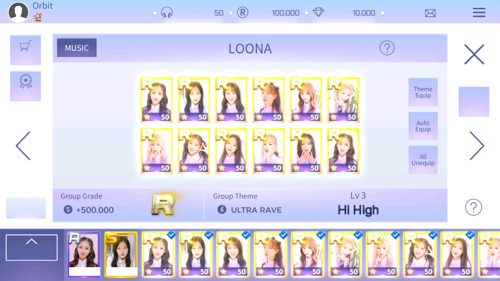

# Walkthrough: Sincronización de Cartas Equipadas e Inventario General

**Fecha:** 19 de Septiembre de 2026  
**Rama:** `feat/card-ui`  
**Autor:** `naxoxhide <irojasangel@gmail.com>`  

---

## 🎯 Objetivo
Resolver la inconsistencia entre el panel superior de tema equipada (**Hi High** en `InvenGroupItemView`) y la bandeja inferior de inventario (`InvenCardView`), estableciendo a [`player_profile.json`](file:///Users/ignaciorojas/Documents/repos/sslo_apk/app/src/main/assets/libscript.js#L479) como la fuente única de verdad para el modo *100% Standalone Offline*.

---

## 🔍 Causa Raíz Diagnosticada
1. **Checkmark Azul (✓) Forzado:** En `createMockSmallCardParams`, el flag `isEquip` estaba codificado fijamente en `1` (`p.add(0x50).writeU8(1)`), lo que provocaba que absolutamente todas las cartas del inventario inferior mostraran el checkmark de equipada.
2. **Discrepancia de Grados (R vs B/A/S/R):** La cabecera del tema cargaba 12 cartas forzadas en Grado R Nivel 50, mientras que la bandeja inferior era renderizada nativamente por Dalcomsoft leyendo desde `CardMap`, poblado por el perfil inicial de pruebas que contenía grados variados (1 B, 3 A, 4 S, 4 R).

---

## 🛠️ Cambios Implementados

1. **Dinamización del Checkmark de Equipamiento (`isEquip`):**
   - En [app/src/main/assets/libscript.js](file:///Users/ignaciorojas/Documents/repos/sslo_apk/app/src/main/assets/libscript.js):
     - `createMockSmallCardParams(cardId, grade, level, isEquip)`: Ahora escribe `p.add(0x50).writeU8(isEquip ? 1 : 0)`.
     - `ViewControl.GetSmallCardViewData` (RVA `0xABEB30`): Extrae el estado real `isEquip = (raw.add(0x28).readU8() === 1)` desde el objeto nativo `Card` y lo traslada a la vista.

2. **Sincronización del Perfil de Usuario (`player_profile.json`):**
   - En `createDefaultProfile`: Se inicializan las 12 cartas oficiales de LOONA (1001 a 1012) en **Grado R Nivel 50** con `isEquip: true`.
   - Se añadieron cartas adicionales en reserva (HeeJin Grado A Lv 1 y HyunJin Grado S Lv 1) con `isEquip: false` para verificar que la bandeja de inventario distingue claramente entre cartas equipadas y en reserva.

3. **Carga Dinámica en la Cabecera de Tema:**
   - En `InventoryScene.GetGroupViewData` (RVA `0x105E8E4`) e `InvenGroupItemView.Refresh` (RVA `0xF23954`), los 12 slots de miembros ahora leen dinámicamente las cartas equipadas del perfil del jugador mediante `loadPlayerProfile()`.

4. **Aislamiento de Slots en `GroupItem`:**
   - Se segmentaron los 12 slots de miembros para `GroupItem.CardItemList` y `EachThemeBestCardItemList`, garantizando que las cartas adicionales del inventario residan en `CardMap` sin causar desbordamiento en las estructuras fijas de Dalcomsoft.

---

## 📸 Evidencia Visual de Verificación

### 1. Escena Completa de Inventario (`InventoryScene`)

* **Group Grade:** Sello Diamond R con resplandor dorado y puntaje `+500.000`.
* **Group Theme:** Multiplicador `⚡ ULTRA RAVE Lv 3` con el logotipo oficial de `Hi High`.
* **Cartas Equipadas:** 12 cartas en Grado R Lv 50 con texturas en alta definición (`_l.i.bytes` con filtrado trilinear y anisotropía x8).

### 2. Detalle de la Bandeja Inferior de Inventario

* **Cartas en Reserva (sin ✓):** Las dos primeras cartas (HeeJin Grado A y HyunJin Grado S) se muestran sin el recuadro azul.
* **Cartas Equipadas (con ✓):** Las 12 cartas del tema *Hi High* se muestran como Grado R Lv 50 con el checkmark azul (✓), idénticas a las equipadas en la cabecera.
