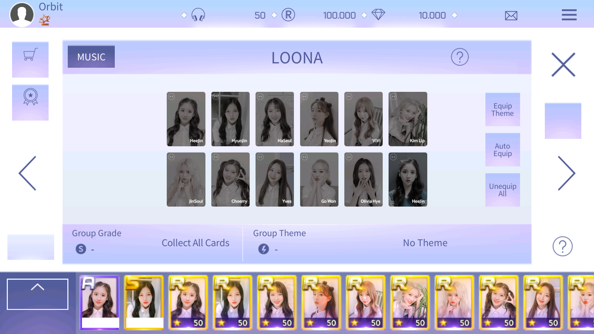
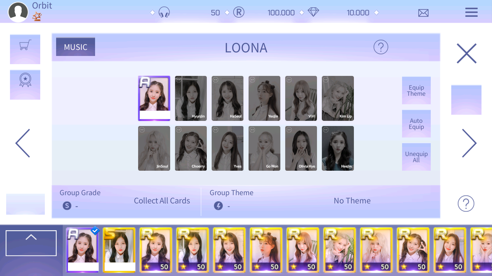
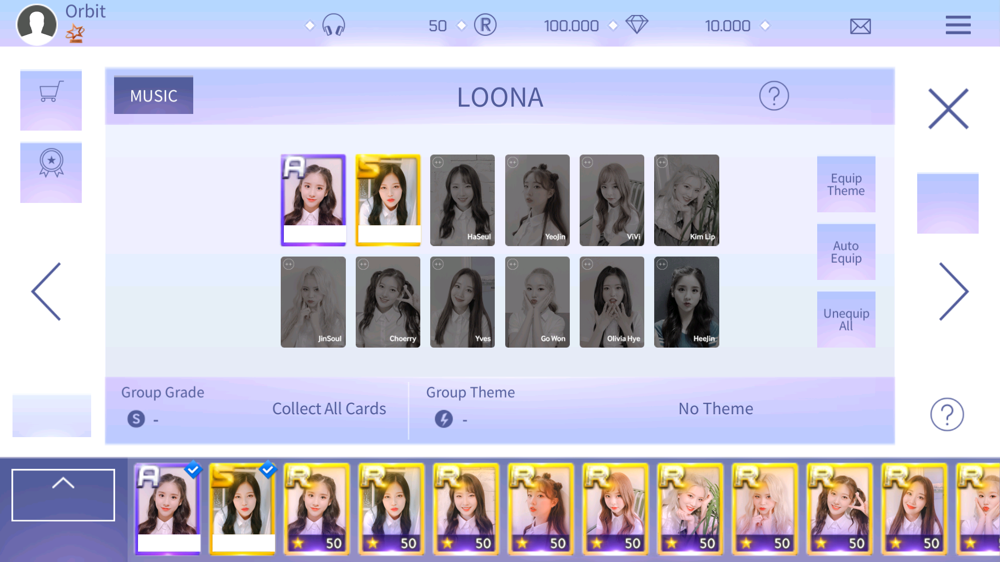
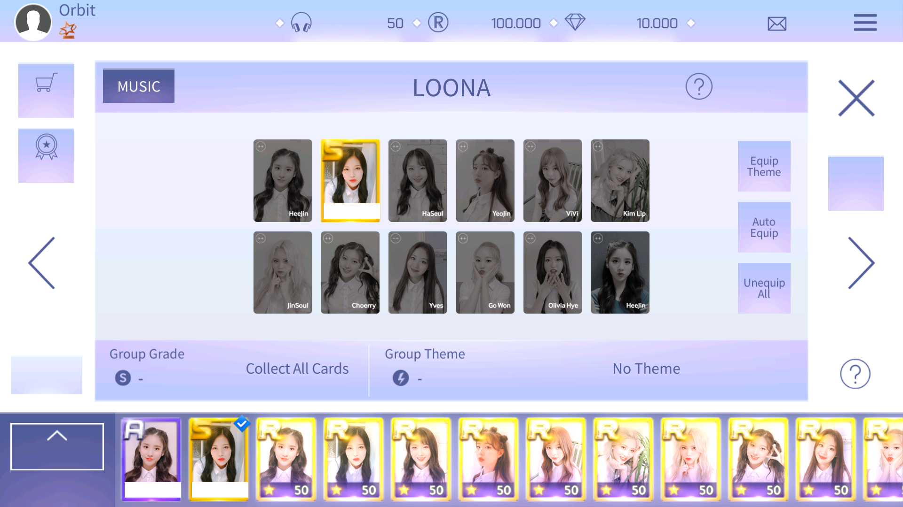

# Walkthrough: Standalone Offline Card Equip, Unequip & Persistence

**Fecha:** 19 de Septiembre, 2026  
**Objetivo:** Perfeccionar el ciclo de vida interactivo de equipar y desequipar cartas (incluyendo Auto Equip, Unequip All y equipamiento/desequipamiento individual) de forma 100% standalone offline, con renderizado en alta definición de siluetas vacías (`sdhgauwehdnu/<cardId>_l.i.bytes`) y persistencia en `player_profile.json`.

---

## 1. Arquitectura e Intercepción de Controladores Dalcomsoft

Se interceptaron los métodos nativos de `InventoryControl` e `InventoryScene` en `libil2cpp.so` para desacoplar el juego de cualquier backend y manejar la mutación localmente:

1. **`InventoryControl.Equip` (RVA `0xF2C374`):**
   - Interceptado con `Interceptor.replace`.
   - Lee `beforeCardItem` y `newCardItem`.
   - Actualiza el flag `isEquip` en `player_profile.json` y en memoria (`Card.isEquip` en offset `0x28`).
   - Reconstruye el `FastArray<CardItem>` del grupo.
   - Ejecuta el callback nativo `callback(0)` señalando éxito instantáneo.
   - Refresca tanto la cabecera `InvenGroupView` como la bandeja de cartas `InvenCardView`.

2. **`InventoryControl.Unequip` (RVA `0xF2C5E4`):**
   - Interceptado con `Interceptor.replace`.
   - Desmarca `isEquip` en disco y memoria utilizando coincidencia estricta por `objectID`.
   - Reconstruye `FastArray` y ejecuta `callback(0)`.

3. **`InventoryScene.OnAutoEquip` (RVA `0x105C024`):**
   - Interceptado con `Interceptor.replace`.
   - Evalúa los 12 miembros de LOONA OT12 en `player_profile.json`.
   - Selecciona la carta con mayor grado (`grade`) y nivel (`level`) para cada miembro.
   - Guarda los 12 IDs equipados en `player_profile.json` y refresca las vistas.

4. **`InventoryScene.OnAllUnequip` (RVA `0x105C158`):**
   - Interceptado con `Interceptor.replace`.
   - Limpia todas las cartas equipadas (`"equipedCards": { "1001": [] }`).
   - Sincroniza en memoria y remueve todos los checkmarks azules de la UI.

5. **`InvenCardEquipView.OnEquip` (RVA `0xF21D7C`) & `InventoryScene.OnEquip` (RVA `0x105AFC8`):**
   - Interceptado con `Interceptor.replace`.
   - En la lógica original de Dalcomsoft, al vaciar todos los slots con "Unequip All", la instrucción en `0x105B088` (`cbz x8, 0x105b194`) abortaba la acción si no existía una carta previa en el slot.
   - Se implementó un manejador offline robusto que toma `newCardItem` de `[0x90]`, ejecuta `handleCardEquipOffline`, actualiza el perfil y retorna ordenadamente a la vista principal mediante `SetStateDefault` (RVA `0x1053B88`).

---

## 2. Renderizado de Siluetas Vacías (Placeholders en Alta Definición)

Cuando un slot del tema no tiene carta equipada:
- **Texturas Canónicas:** Se cargan desde `asiudgasg/asodhsg/sdhgauwehdnu/<cardId>_l.i.bytes`, garantizando nitidez completa en alta resolución.
- **Supresión de Elementos de Interfaz:**
  - `setTierVis(0)`: Desactiva el marco del grado (R, S, A, B, C).
  - `setStarVis(0)`: Desactiva el icono de estrellas.
  - `setNumVis(0)`: Desactiva el nivel numérico.
  - El nombre del miembro permanece visible y nítido sobre la silueta gris.
- **Preservación de Subdirectorio:** En `URLsControl.SetCdnTexture` (RVA `0x163A9E8`), se respetan las peticiones que contienen `sdhgauwehdnu/`, impidiendo que las siluetas vacías retrocedan a `wadceg/`.

---

## 3. Corrección de Identidad de Cartas (`objectID` vs `cardID`)

- **Problema:** Anteriormente, `handleCardEquipOffline` evaluaba `c.cardID == cardId`, lo que provocaba que todas las cartas de un mismo miembro (ej. HeeJin Grado R y HeeJin Grado A, ambas con `cardID: 1001`) se marcaran como equipadas al mismo tiempo.
- **Solución:** Se restringió la validación a `c.objectID.toString() === objId.toString()`, garantizando que cada miembro tenga una única carta activa en cualquier momento.

---

## 4. Evidencia Visual y Flujos Validados en Emulador

### 4.1. Desequipar Todo ("Unequip All")
Al pulsar el botón **Unequip All** (x=1630, y=570), los 12 slots muestran sus siluetas vacías en gris de `sdhgauwehdnu/` sin marcos ni estrellas. Todos los checkmarks azules se remueven de la bandeja inferior:

### 4.2. Modal Comparativo de Equipamiento
Al seleccionar una carta en reserva (ej. HeeJin Grado A) y pulsar el botón de cambio, se despliega el modal comparativo contra el estado actual:

### 4.3. Equipar Carta Individual (HeeJin Grado A en Slot 0)
Al pulsar el botón de equipar, Slot 0 se actualiza a HeeJin Grado A con su marco morado. Los slots 1 a 11 se mantienen como siluetas vacías, y únicamente HeeJin Grado A adquiere el checkmark azul (`✓`) en la bandeja:

### 4.4. Equipar Segunda Carta Individual (HyunJin Grado S en Slot 1)
Al seleccionar HyunJin Grado S y equiparla, Slot 1 se llena con el marco dorado S. Los slots 2 a 11 se mantienen vacíos:

### 4.5. Desequipar Carta Individual
Al pulsar la carta equipada y presionar el botón de checkmark en el modal, Slot 0 regresa a silueta vacía sin marco ni estrellas, y su checkmark es removido de la bandeja inferior:

### 4.6. Auto-Equipar ("Auto Equip")
Al pulsar **Auto Equip** (x=1630, y=450), el sistema evalúa a las 12 integrantes y equipa las mejores cartas disponibles (Grado R Nivel 50), restaurando los 12 checkmarks azules y el efecto `Group Grade R (+500.000)` con `⚡ ULTRA RAVE Lv 3 Hi High`:

---

## 5. Persistencia en Disco

Todas las mutaciones se guardan inmediatamente en `/sdcard/Android/data/com.dalcomsoft.sslo/files/player_profile.json` (`chmod 666`), garantizando que al reiniciar la aplicación o cambiar de escena el estado se preserve al 100%.
