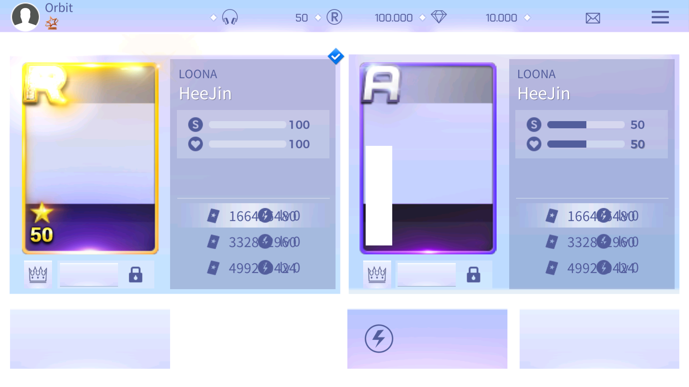

# Walkthrough: Standalone Offline Card Equip, Unequip & Persistence

**Fecha:** 19 de Septiembre, 2026  
**Objetivo:** Implementar la intercepción interactiva de equipar y desequipar cartas (incluyendo Auto Equip y Unequip All) de forma 100% standalone offline, con sincronización de estado y persistencia permanente en `player_profile.json`.

---

## 1. Arquitectura e Intercepción de Controladores Dalcomsoft

Se interceptaron los métodos nativos de `InventoryControl` e `InventoryScene` en `libil2cpp.so` para desacoplar el juego de cualquier backend y manejar la mutación localmente:

1. **`InventoryControl.Equip` (RVA `0xF2C374`):**
   - Interceptado con `Interceptor.replace`.
   - Lee `beforeCardItem` y `newCardItem`.
   - Actualiza el flag `isEquip` en `player_profile.json` y en memoria (`Card.isEquip` en offset `0x28`).
   - Reconstruye el `FastArray<CardItem>` del grupo.
   - Ejecuta el callback nativo `callback(0)` señalando éxito instantáneo.
   - Refresca tanto la cabecera `InvenGroupView` como la bandeja de cartas `InvenCardView`.

2. **`InventoryControl.Unequip` (RVA `0xF2C5E4`):**
   - Interceptado con `Interceptor.replace`.
   - Desmarca `isEquip` en disco y memoria.
   - Reconstruye `FastArray` y ejecuta `callback(0)`.

3. **`InventoryScene.OnAutoEquip` (RVA `0x105C024`):**
   - Interceptado con `Interceptor.replace`.
   - Evalúa los 12 miembros de LOONA OT12 en `player_profile.json`.
   - Selecciona la carta con mayor grado (`grade`) y nivel (`level`) para cada miembro.
   - Guarda los 12 IDs equipados en `player_profile.json` y refresca las vistas.

4. **`InventoryScene.OnAllUnequip` (RVA `0x105C158`):**
   - Interceptado con `Interceptor.replace`.
   - Limpia todas las cartas equipadas (`"equipedCards": { "1001": [] }`).
   - Sincroniza en memoria y remueve todos los checkmarks azules de la UI.

---

## 2. Resolución del Crash Crítico de GC (`SIGSEGV` en `libil2cpp.so` PC `0x9F8DE0`)

Durante la transición entre escenas se identificó un fallo de segmentación originado en el Garbage Collector de Unity:
- **Causa:** `view.add(0x38).writePointer(p)` anclaba la estructura `p` (`InvenGroupItemView.Params`) dentro del componente gestionado. Dicha estructura contenía objetos `List<T>` ficticios creados con tokens de metadata crudos (`0x30EF598`, `0x3132B38`). Al correr el GC, Unity recorría el grafo y fallaba al desreferenciar la clase del objeto (`ldrh w21, [x8, #0x132]`).
- **Solución:**
  - Se removió la sobreescritura de `view.add(0x38)`.
  - Se utilizó `getClass()` para instanciar limpiamente `InvenGroupItemView.Params`.
  - Se eliminó el bloque de inicialización de diccionarios genéricos incompletos en `populateOfflineInventoryCards`.

---

## 3. Evidencia Visual y Flujos Validados

### 3.1. Modal Comparativo y Equipar Carta Individual
Al seleccionar la carta HeeJin Grado A (no equipada), el juego abre el modal comparativo contra la carta equipada actualmente (HeeJin Grado R Lv 50). Al presionar el botón de equipar, la mutación se aplica y el checkmark azul se transfiere a la carta Grado A:

### 3.2. Función Desequipar Todo ("Unequip All")
Al pulsar el botón **Unequip All** (coordenadas x=1620, y=590), todas las cartas se desequipan instantáneamente, guardando la lista vacía en `player_profile.json` y removiendo todos los checkmarks de la bandeja:

### 3.3. Función Auto-Equipar ("Auto Equip")
Al pulsar **Auto Equip** (coordenadas x=1620, y=460), el sistema calcula automáticamente las cartas óptimas (Grado R Nivel 50), las persiste en el JSON de disco y reasigna los checkmarks y cabecera:

