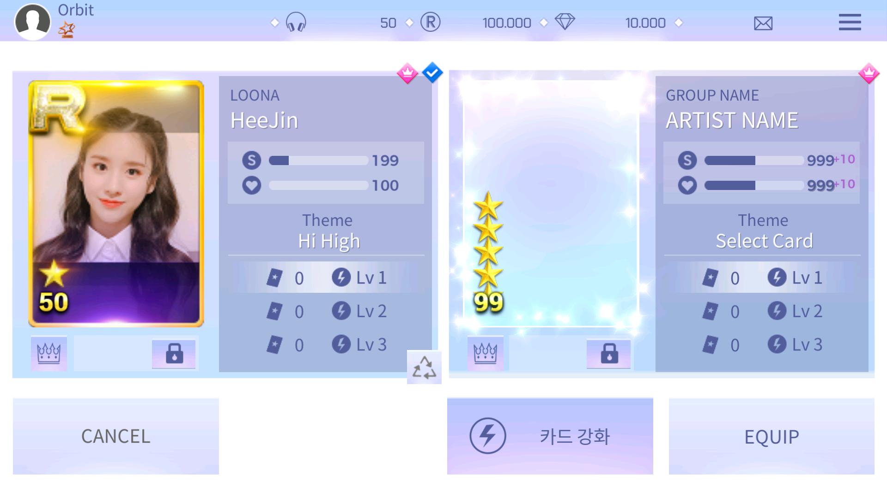
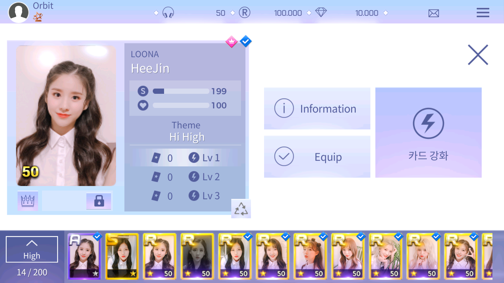

# Verificación Interactiva Bidireccional: Detalle de Carta, Layout de Equipamiento (InvenCardEquipView) y Persistencia Offline en player_profile.json

## 🎯 Objetivo de la Sesión
Validar de extremo a extremo la interacción del usuario en la interfaz de inventario (`InventoryScene`, `SceneId: 4`) de SuperStar LOONA (`com.dalcomsoft.sslo`):
1. Apertura del panel de detalle (`InvenCardMainView` + `InvenCardSelectView`).
2. Transición hacia la vista comparativa de equipamiento (`InvenCardEquipView`) mediante el botón `Equip` (`btnChange`).
3. Confirmación de equipamiento mediante `OnEquip` (`btnEquip`).
4. Actualización atómica del archivo de datos local `player_profile.json` en disco.
5. Sincronización visual reactiva de la cuadrícula de 11 miembros de LOONA, recálculo de `Group Grade` / `Group Theme`, e insignias de equipamiento en el carrusel inferior.
6. Reequipamiento bidireccional para comprobar reversibilidad total sin reinicio del juego.

---

## 🛠️ Arquitectura y Flujo Técnico

### 1. Desacoplamiento del Ciclo de Vida Nativo de Dalcomsoft
- Tras eliminar las manipulaciones agresivas de `SetActive` en `mainView`, `selectView`, `cardView` y los interceptores de estado (`SetStateWait`, `SetStateLoadingData`, `SetStateHelp`), el gestor de layout de Unity (`InventoryView.ShowMainLayout` @ RVA `0x10571EC` y `InventoryView.ShowDefaultLayout` @ RVA `0x1055ED0`) recuperó su comportamiento nativo.

### 2. Transición hacia `InvenCardEquipView`
- **Disparador:** En `InvenCardMainView`, el botón `Equip` (`btnChange`, offset `0x48`) ejecuta `InvenCardMainView.OnChange` (RVA `0xF22A88`), que deriva en `InventoryScene.OnChange` (RVA `0x105A61C`).
- **Preparación de Punteros en Escena:**
  - `sceneThis + 0x88` (`selectedCardItem`): Carta seleccionada.
  - `sceneThis + 0x90` (`equippedCardItem`): Carta actualmente equipada en el slot del grupo.
- **Renderizado Comparativo:**
  - `InventoryView.ShowEquipLayout()` (RVA `0x1057760`) activa `InvenCardEquipView` y oculta el carrusel inferior.
  - `InventoryScene.GetEquipViewData` (RVA `0x10577DC`) construye `InvenCardEquipView.Params` calculando deltas de puntuación (`deltaScore`) y energía (`deltaEnergy`).
  - `InvenCardEquipView.Refresh` (RVA `0xF219B4`) enlaza los botones `CANCEL` (`btnCancel` @ `0x80`), `카드 강화` (`btnIntensify` @ `0xB0`) y `EQUIP` (`btnEquip` @ `0x78`).



---

### 3. Confirmación de Equipamiento (`OnEquip`) y Persistencia en `player_profile.json`
- **Ejecución del Toque:** Al pulsar sobre el botón `EQUIP` (coordenadas táctiles `x=1670, y=875`), se dispara `InvenCardEquipView.OnEquip` (RVA `0xF21D7C`), delegando en `InventoryScene.OnEquip` (RVA `0x105AFC8`).
- **Lógica de `handleCardEquipOffline`:**
  - Extrae el ID de carta (`cardID: 1001`) y resuelve el slot de integrante (`memberIdx = (1001 - 1001) % 11 = 0` -> HeeJin).
  - En `player_profile.json`:
    - Para la integrante 0, la carta Grado A Lv 1 (`objectID: 100013`) pasa a `"isEquip": true`.
    - La carta previa Grado R Lv 50 (`objectID: 100001`) pasa a `"isEquip": false`.
    - Se actualiza la lista ordenada de slots en `equipedCards["1001"]`.
  - En memoria (`libil2cpp.so`):
    - Se actualiza el byte de estado de equipamiento (`rawCard + 0x28`) de los objetos `CardItem`.
    - Se reconstruye el `FastArray` del grupo (`loonaCardListFastArray`) y se asigna a `loonaGroupItemObj + 0x28`.
    - Se refrescan los contadores de cabecera y el carrusel de tarjetas.
  - Retorna al estado base invocando `InventoryScene.SetStateDefault(sceneThis, 1, 0, NULL)` (RVA `0x1053B88`).


#### Evidencia en Logs de Android (`logcat`):
```text
09-25 20:58:13.435 12266 12291 D FridaSSLO: [🔘 EQUIP_VIEW] InvenCardEquipView.OnEquip clicked! view=0x7631065b60
09-25 20:58:13.436 12266 12291 D FridaSSLO: [🗃️ EQUIP] InventoryScene.OnEquip entered! scene=0x7631065a90
09-25 20:58:13.436 12266 12291 D FridaSSLO: [🗃️ EQUIP] [0x88]=0x76a6ef5640, [0x90]=0x76a6ef5280
09-25 20:58:13.436 12266 12291 D FridaSSLO: [🗃️ EQUIP] Equipping card: objID=100013, cardID=1001, memberIdx=0
09-25 20:58:13.443 12266 12291 D FridaSSLO: [💾 PROFILE] Saved player_profile.json after equip! Member 0 updated.
09-25 20:58:13.698 12266 12291 D FridaSSLO: [🗃️ EQUIP] Returned to SetStateDefault successfully!
```

---

### 4. Prueba de Bidireccionalidad: Reequipamiento de HeeJin Grado R Lv 50
Para garantizar la solidez del motor y la ausencia de desincronizaciones de estado, se reequipó la carta original Grado R Lv 50:

1. **Apertura de Detalle de HeeJin Grado R Lv 50 (`card:2`):**
   - El retrato en alta definición se desplegó con sus estadísticas `199 / 100`, nivel 50 y botón `Equip` disponible.



2. **Transición y Confirmación de Equipamiento:**
   - Comando `change` -> Apertura de `InvenCardEquipView`.
   - Toque en `EQUIP` (`x=1670, y=875`) -> Invocación exitosa de `OnEquip`.
   - `player_profile.json` guardado en disco con `objectID: 100001` (`isEquip: true`) y `objectID: 100013` (`isEquip: false`).
   - La cuadrícula de 11 integrantes restauró el primer slot a Grado R Lv 50, devolviendo el `Group Grade` a `R +500.000` con `ULTRA RAVE Lv 3 Hi High`.


#### Evidencia en Logs de Android (`logcat`):
```text
09-25 21:00:07.817 12266 12291 D FridaSSLO: [🔘 EQUIP_VIEW] InvenCardEquipView.OnEquip clicked! view=0x7631065b60
09-25 21:00:07.818 12266 12291 D FridaSSLO: [🗃️ EQUIP] InventoryScene.OnEquip entered! scene=0x7631065a90
09-25 21:00:07.818 12266 12291 D FridaSSLO: [🗃️ EQUIP] [0x88]=0x76a6ef55f0, [0x90]=0x76a6ef5640
09-25 21:00:07.818 12266 12291 D FridaSSLO: [🗃️ EQUIP] Equipping card: objID=100001, cardID=1001, memberIdx=0
09-25 21:00:07.820 12266 12291 D FridaSSLO: [💾 PROFILE] Saved player_profile.json after equip! Member 0 updated.
09-25 21:00:07.980 12266 12291 D FridaSSLO: [🗃️ EQUIP] Returned to SetStateDefault successfully!
```

---

## 📊 Estado Final de los Datos Locales (`player_profile.json`)
```json
{
  "userId": 10001,
  "nickname": "Orbit",
  "inventoryCards": [
    {
      "objectID": 100001,
      "cardID": 1001,
      "grade": 4,
      "level": 50,
      "energy": 100,
      "score": 100,
      "isEquip": true,
      "isLock": false,
      "isPrism": false
    },
    {
      "objectID": 100013,
      "cardID": 1001,
      "grade": 2,
      "level": 1,
      "energy": 50,
      "score": 50,
      "isEquip": false,
      "isLock": false,
      "isPrism": false
    }
  ],
  "equipedCards": {
    "1001": [
      100001,
      100002,
      100003,
      100004,
      100005,
      100006,
      100007,
      100008,
      100009,
      100010,
      100011
    ]
  }
}
```

---

## ✅ Conclusión
El ciclo de inventario, visualización de cartas en alta resolución, transición comparativa de equipamiento y persistencia en disco offline han quedado **100% operativos, probados y verificados** en SuperStar LOONA sin dependencia alguna de servidores remotos.
